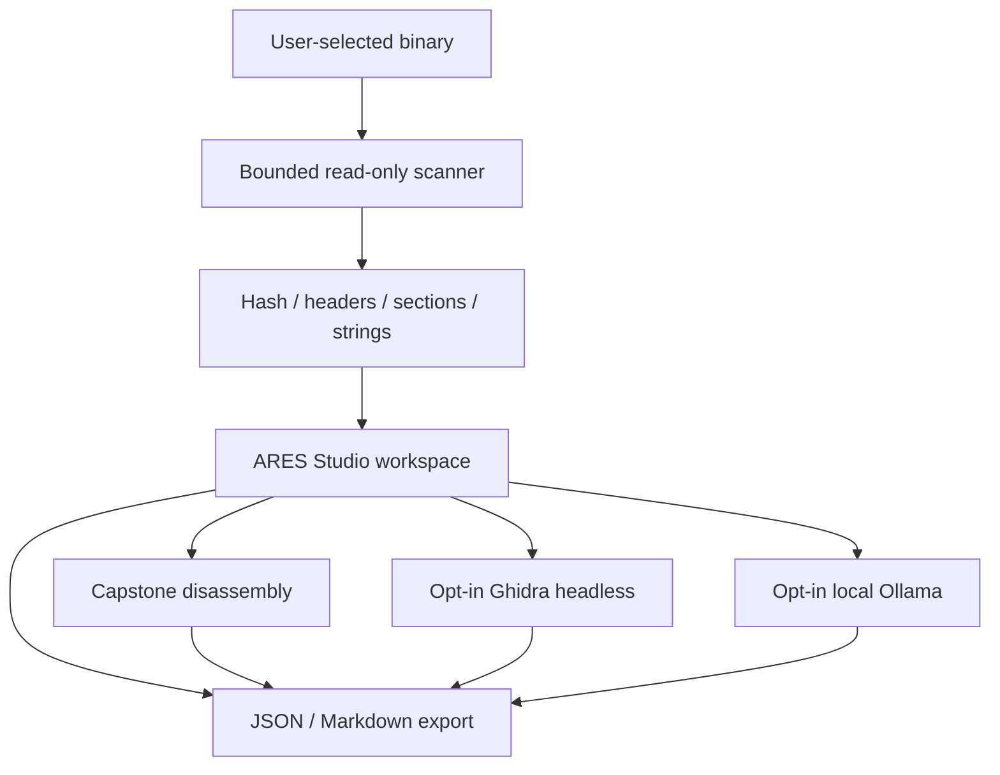

<div align="center">
  

# ARES Studio

**AI Reverse Engineering Studio**

Local-first binary inspection and AI-assisted software understanding for Windows, macOS, and Linux.

[Getting Started](#getting-started) · [Architecture](docs/ARCHITECTURE.md) · [Security](SECURITY.md) · [Contributing](CONTRIBUTING.md)


</div>

---

## Understand the binary. Keep the evidence local.

ARES Studio is an independent, open-source desktop workspace for inspecting executable formats and forming defensible reverse-engineering hypotheses. The desktop app is intended for developers, security researchers, students, and forensic teams working with software they are authorized to inspect.

The built-in inspector makes useful observations without executing the analyzed program. Optional integrations connect an existing **Ghidra** installation for decompilation and a locally running **Ollama** model for concise, evidence-aware explanations.

> **Release status:** v0.1.0 engineering preview. Source inspection and automated unit tests are implemented; native installers require GitHub Actions builds and physical OS validation. It is not an execution sandbox or certified malware-analysis appliance.

## Product capabilities

| Workspace | Capability | Operation |
| --- | --- | --- |
| **Overview** | PE / ELF / Mach-O recognition, sections, architecture, entry point and SHA-256 | Built in |
| **Strings Explorer** | Bounded printable strings with real-time filter | Built in |
| **Disassembly** | Machine-code instructions at the mapped entry point | Optional Capstone |
| **Ghidra Analysis** | Function discovery and decompiled snippets | Optional local Ghidra |
| **Local AI Assistant** | Analyst explanations from binary metadata and optional decompilation | Optional local Ollama |
| **Reports & Export** | Export machine-readable JSON or Markdown analysis reports | Built in |

**Architecture at a glance**



The application deliberately does **not** promise behavioral emulation, automatic source recovery, a security verdict, or cloud AI services.

## Getting started

### Option A — Download a native build

After the CI workflow runs on GitHub, open the repository's **Actions → Test, build and publish** page and download the appropriate artifact. When a version tag is created and its draft release is approved, published assets appear under **Releases**.

| System | Distribution | Notes |
| --- | --- | --- |
| Windows 10/11 x64 | NSIS `.exe` installer or portable `.zip` | Unsigned preview; SmartScreen may warn |
| macOS Intel / Apple Silicon | Separate `.dmg` images | Unsigned/unnotarized; Gatekeeper may warn |
| Ubuntu/Debian x64 | `.deb` installer | Installs application shortcut |
| Other x64 Linux | Portable `.tar.gz` | Extract and run `ARES-Studio` from the folder |

These artifacts must be built by the workflows; this source repository does not contain pre-built binaries.

### Option B — Run from source

Requires Python 3.11+ and a compatible desktop environment.

```bash
# Clone after repository publication
# git clone https://github.com/hossain0707/AI-Reverse-Engineering-Studio.git
# cd AI-Reverse-Engineering-Studio

python -m venv .venv
# On Windows PowerShell: .venv\Scripts\Activate.ps1
# On macOS/Linux: source .venv/bin/activate
python -m pip install -e '.[disassembly]'
ares-studio
```

To inspect a binary from the terminal without launching a window:

```bash
ares-cli ./path/to/authorized-sample --format json
ares-cli ./path/to/authorized-sample --out assessment.md
```

### Optional Ghidra integration

1. Download and install [Ghidra](https://github.com/NationalSecurityAgency/ghidra) from its official project.
2. Open ARES Studio, select a binary, and go to **Ghidra Analysis**.
3. Select the Ghidra installation root directory (containing `support/analyzeHeadless`).
4. Confirm the separate analyzer trust-boundary warning, then run decompilation.
5. Review the bounded function list and decompiled snippets. Export a report if required.

Ghidra is a third-party executable that inspects untrusted input. ARES does not sandbox it. Use an isolated VM for hostile samples. Only inspect files with authorization.

### Optional private AI explanations

1. Install [Ollama](https://ollama.com) and start its **local** server.
2. Download any locally supported coding model, for example `ollama pull qwen2.5-coder:7b`.
3. Enter the installed model name in **Local AI Assistant** and keep the endpoint as `http://127.0.0.1:11434`.
4. Select **Explain current binary**. Interpret the response as unverified guidance, not an authoritative result.

Only local loopback HTTP endpoints are accepted by ARES. No API keys, external cloud model, or upload are required. Model download itself uses Ollama's own distribution channel.

## Design principles

- **Local by default:** no application telemetry, signup, external AI API or binary upload.
- **Reproducibility:** SHA-256 and deterministic, structured report content with explicit scan limitations.
- **Analyst agency:** clear distinction between observed metadata and suggestions from a language model.
- **Guardrails:** file-size and scan limits, subprocess timeouts, capped output, explicit Ghidra opt-in.
- **Cross-platform:** a Qt UI from a shared Python codebase; native packaging per operating system.
- **Transparent scope:** no fake binary execution, fake screenshots, fabricated detections, or unsupported claims.

## Repository structure

```text
src/ares_studio/
  app.py             Desktop interface and background workers
  core.py            Static PE / ELF / Mach-O inspector
  disassembly.py     Optional Capstone decoder
  ghidra.py          Optional Ghidra headless orchestrator
  ollama.py          Loopback-only local AI adapter
  reporting.py       Markdown and JSON report serialization
  cli.py             Headless command-line interface
scripts/ghidra/      Companion Jython export script
packaging/           Windows NSIS and Linux desktop integration
.github/workflows/   Automated test and native-build pipeline
tests/               Parser, local endpoint and report tests
docs/                Architecture and engineering documentation
```

## Quality and release discipline

Local verification:

```bash
python -m pip install -e '.[dev]'
python -m pytest -q
python -m ruff check .
```

Each CI build runs tests and then packages on native GitHub runners. Tagged releases produce a **draft**, not an automatically published or attested release. See [the development guide](docs/DEVELOPMENT.md) for installer signing, smoke testing, and remaining production gates.

## Roadmap

- [x] Core read-only binary inspector and reports
- [x] Desktop navigation, string filtering and background processing
- [x] Optional local decompiler and LLM integrations
- [x] Cross-platform packaging definitions
- [ ] Verify app functionality and signed installers on all target OS/CPU combinations
- [ ] Test Ghidra integrations across supported releases
- [ ] Add fuzzing and differential tests against mature parser libraries
- [x] CI packaging configurations for Intel and Apple Silicon macOS
- [ ] Verify macOS native binaries and add native ARM Linux builds
- [ ] Investigate isolate-by-default parser subprocesses for hostile samples
- [ ] Project/workspace history, annotated symbols, cross-references, and diffing

## Licensing

MIT License © 2026 **Md Najmul Hossain**. See [LICENSE](LICENSE).

ARES Studio is an independent project and is **not affiliated with or endorsed by Ghidra, the NSA, Capstone, or Ollama**. Third-party tools retain their respective licenses.
