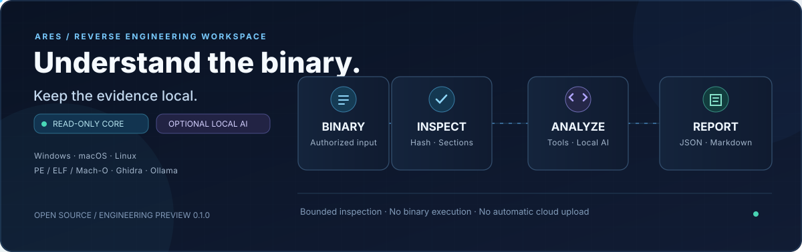
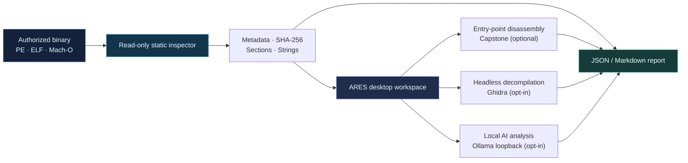

<div align="center">



# ARES Studio
### AI Reverse Engineering Studio

**Local-first binary intelligence for developers, security researchers, and forensic analysts.**

Explore executable structure, reason about disassembly, optionally decompile with Ghidra, and use a local language model to document findings — without sending your binaries to a hosted analysis service.

<p>
  <a href="https://github.com/hossain0707/AI-Reverse-Engineering-Studio/actions/workflows/ci-release.yml"></a>
  
  
  
  
</p>

[**Installation**](#installation) · [**Capabilities**](#capabilities) · [**Architecture**](#architecture) · [**Security**](#security-and-trust-boundaries) · [**Development**](#development-and-verification) · [**Roadmap**](#roadmap)

</div>

---

> [!IMPORTANT]
> **Engineering preview, not a certified production release.** Source analysis, CLI functionality, and automated tests are implemented. Windows, macOS, and Linux distributions are produced by CI and must be checked individually for successful builds and native runtime behavior. Unsigned/unnotarized artifacts are not production-certified. There is no safe-execution sandbox for malicious binaries.

## Why ARES Studio?

Traditional static analysis produces large volumes of low-level data. ARES Studio organizes a **read-only first pass** into a coherent desktop workspace and lets the analyst selectively add local tooling where deeper context is needed.

- **Evidence before inference:** hashes, headers, mapped sections, strings, and instructions are distinct from AI-generated commentary.
- **Private by design:** the built-in core does not execute the selected binary, collect telemetry, or upload samples.
- **Bring your own tools:** opt into an existing Ghidra installation or an Ollama model running on loopback.
- **Portable workflow:** one Qt codebase with dedicated Windows, macOS, and Linux packaging jobs.
- **Reproducible hand-off:** export structured JSON or readable Markdown for analysis notes.

## Capabilities

| Workspace | What it provides | Availability |
| :-- | :-- | :-- |
| **Overview** | Format identification (PE, ELF, Mach-O), architecture, size, sampled entropy, sections, SHA-256 | Built in |
| **Strings Explorer** | Bounded printable-string extraction and in-app filtering | Built in |
| **Disassembly** | Entry-point instruction view with supported architectures | Optional [Capstone](https://www.capstone-engine.org/) |
| **Ghidra Analysis** | Function discovery and bounded decompiled text | Optional [Ghidra](https://github.com/NationalSecurityAgency/ghidra) |
| **Local AI Assistant** | Context-aware natural-language explanations based on local observations | Optional [Ollama](https://ollama.com/) |
| **Reports & Export** | JSON or Markdown analysis summaries | Built in |

**Deliberate limits:** ARES does not claim automated complete source recovery, reliable malware verdicts, dynamic execution analysis, or cloud-based inference. AI output is a hypothesis to review, never ground truth.

## Installation

### Download desktop packages

**Repository:** [GitHub releases](https://github.com/hossain0707/AI-Reverse-Engineering-Studio/releases) · [Latest CI build artifacts](https://github.com/hossain0707/AI-Reverse-Engineering-Studio/actions/workflows/ci-release.yml)

| Operating system | Planned artifact | CPU architecture | Release caveat |
| :-- | :-- | :-- | :-- |
| Windows 10/11 | `ARES-Studio-Setup-0.1.0.exe`, portable `.zip` | x86-64 | Unsigned preview; SmartScreen may prompt |
| macOS | `ARES-Studio-macos-x64.dmg` | Intel | Unnotarized preview; Gatekeeper may prompt |
| macOS | `ARES-Studio-macos-arm64.dmg` | Apple Silicon | Unnotarized preview; Gatekeeper may prompt |
| Ubuntu / Debian | `ares-studio_0.1.0_amd64.deb` | x86-64 | Native compatibility requires verification |
| Other Linux | `ARES-Studio-Linux-Portable.tar.gz` | x86-64 | Desktop dependencies are distro-specific |

> Packages are **only available if their associated GitHub Actions jobs finish successfully**. Source presence and a workflow definition do not mean installers already exist. The release process intentionally creates a draft release, never an automatically trusted public installer.

### Run from source

**Prerequisites:** Python 3.11+ and a graphical desktop environment.

```bash
git clone https://github.com/hossain0707/AI-Reverse-Engineering-Studio.git
cd AI-Reverse-Engineering-Studio
python -m venv .venv
```

Activate the environment:

| Platform | Command |
| :-- | :-- |
| Windows PowerShell | `.venv\Scripts\Activate.ps1` |
| macOS / Linux | `source .venv/bin/activate` |

Then install and start the app:

```bash
python -m pip install --upgrade pip
python -m pip install -e ".[disassembly]"
ares-studio
```

### Use the CLI without the desktop UI

```bash
ares-cli ./samples/authorized-executable --format json
ares-cli ./samples/authorized-executable --out notes.md
```

See [the development guide](docs/DEVELOPMENT.md) for additional developer and packaging details.

## Architecture



The pipeline is intentionally **explicit and analyst-controlled**. Ghidra and Ollama are not started simply because a sample is opened. Read [Architecture](docs/ARCHITECTURE.md) for module boundaries and the [Security Policy](SECURITY.md) for operational limitations.

### Optional Ghidra integration

1. Install Ghidra from the [official repository](https://github.com/NationalSecurityAgency/ghidra).
2. Open an authorized binary in ARES Studio and navigate to **Ghidra Analysis**.
3. Point ARES Studio at the Ghidra installation directory containing `support/analyzeHeadless`.
4. Review the separate trust-boundary warning and explicitly start the operation.
5. Inspect the returned functions and decompilation snippets before exporting.

**Risk:** Ghidra processes untrusted inputs in a separate executable, but ARES does **not** place Ghidra in an isolation sandbox. Use a properly isolated VM for hostile artifacts.

### Optional local AI integration

```bash
# Install and start Ollama locally first.
ollama pull qwen2.5-coder:7b
```

In **Local AI Assistant**, set the model to your installed model and the endpoint to `http://127.0.0.1:11434`, then select **Explain current binary**.

ARES accepts loopback HTTP endpoints only; no cloud API credentials are required. Model downloads are performed separately by Ollama. Verify generated claims against the observed evidence.

## Security and trust boundaries

| Boundary | Current behavior |
| :-- | :-- |
| Executable inspection | Static and read-only; selected programs are not run |
| Memory / scan size | Configured bounds, limits, and output caps |
| Ghidra subprocess | Explicit opt-in, timeout, temporary project; **not sandboxed** |
| AI connectivity | Explicit opt-in; loopback-only Ollama endpoint |
| Data transmission | No first-party telemetry or automatic sample upload |
| Malware safety | **Not** a certified containment or malware-execution system |

Only analyze binaries you have the right to inspect. For vulnerabilities, use private reporting instructions in [SECURITY.md](SECURITY.md); do not publish exploit details against third-party targets.

## Development and verification

```bash
python -m pip install -e ".[dev]"
python -m ruff check .
python -m pytest -q
```

CI runs linting and tests before creating per-platform packages. The [build workflow](.github/workflows/ci-release.yml) uploads installation artifacts from successful runner jobs. Tag builds prepare a **draft release** for manual review.

**Before declaring production-ready:** pass native launch, installation and removal, application functionality, dependency compatibility, Ghidra integration, signed distribution, macOS notarization, security fuzzing, and end-to-end smoke testing. See [DEVELOPMENT.md](docs/DEVELOPMENT.md).

<details>
<summary><strong>Repository structure</strong></summary>

```text
src/ares_studio/
  app.py                  Qt desktop workspace
  core.py                 Static PE / ELF / Mach-O inspection
  disassembly.py          Optional Capstone instruction decoding
  ghidra.py               Optional Ghidra adapter
  ollama.py               Local-only model adapter
  reporting.py            Report generation
  cli.py                  Command-line interface
  resources/              Icons and Ghidra companion script
assets/                    README visual assets
packaging/                 Native installation metadata
scripts/                   Developer and publishing utilities
tests/                     Automated regression checks
docs/                      Engineering, design, and operating notes
.github/workflows/         CI and release automation
```

</details>

## Roadmap

- [x] Static binary metadata, bounded strings, SHA-256, and reports
- [x] Six-workspace Qt desktop UI
- [x] Optional Ghidra, Capstone, and local Ollama adapters
- [x] Automated packaging configurations for Windows, macOS (Intel/ARM), and Linux x64
- [ ] Confirm all native build artifacts and installation smoke tests on their actual platforms
- [ ] Add signed Windows binaries and signed/notarized macOS distribution
- [ ] Fuzz format parsers and validate against reference implementations
- [ ] Test multiple supported Ghidra versions and timeout/error scenarios
- [ ] Expand binary cross-references, function diffing, and analyst project management
- [ ] Improve parser isolation for genuinely hostile samples

## Project and licensing

**Author and maintainer:** [Md Najmul Hossain](https://github.com/hossain0707)

- [Contribution guidelines](CONTRIBUTING.md) · [Security policy](SECURITY.md) · [Changelog](CHANGELOG.md)
- Licensed under the [MIT License](LICENSE) © 2026 Md Najmul Hossain
- Independent project, **not affiliated with or endorsed by** Ghidra, NSA, Capstone, or Ollama. Dependencies retain their own licenses.

<div align="center"><sub>Built to help analysts work methodically, privately, and with verifiable evidence.</sub></div>
