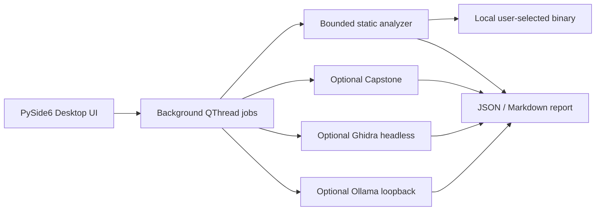

# Architecture and component boundaries

ARES Studio is a Python/PySide6 desktop application designed for local-first, read-only binary inspection.

## Component responsibilities

| Module | Responsibility | External execution | Network |
| --- | --- | --- | --- |
| `core.py` | ELF, PE, Mach-O headers; bounded strings; SHA-256; entropy | None | None |
| `disassembly.py` | Optional Capstone entry-point decoding | None | None |
| `ghidra.py` | User-approved headless Ghidra subprocess + bounded export | Ghidra only | Not initiated by ARES |
| `ollama.py` | Fixed loopback HTTP endpoint for installed local Ollama models | None | 127.0.0.1 / ::1 only |
| `reporting.py` | Deterministic Markdown/JSON | None | None |
| `cli.py` | Scriptable static inspection | None | None |
| `app.py` | Desktop UI and background tasks | None | None |

## Binary inspection constraints

- The selected sample is opened in read-only mode, not executed or imported dynamically.
- Maximum file size: 256 MiB. SHA-256 is computed over the complete file in 1 MiB chunks.
- Entropy and printable strings scan the first 16 MiB. Distinct strings capped at 1,200.
- Header parsing is strict and bounded; malformed headers show warnings instead of aborting inspection.
- Disassembly is restricted to a 4 KiB window at a verified mapped entry point (up to 180 instructions).
- Ghidra integration uses a disposable temporary project and per-file timeout. Ghidra is a third-party engine which may have its own risks and networking behavior; ARES does not sandbox Ghidra.
- Local AI context is bounded. It treats all extracted strings and decompilation as untrusted data; LLM output is never an automatic verdict.

## Trust boundary and limitations

No one-click software cloning, license bypassing, automated patching, or malware execution. The interface provides analyst assistance, not a virtual machine, detonation sandbox, or complete decompiler on its own. File parsers are custom and have limited format coverage. Do not rely on this as the sole control for production malware triage. Use isolated VMs when investigating potentially hostile samples.

See [SECURITY.md](../SECURITY.md) and [developer notes](DEVELOPMENT.md).
